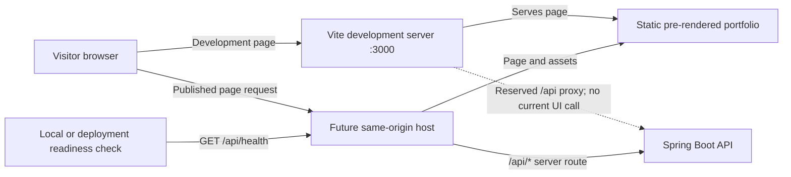

# Architecture

## Overview

I split my portfolio into a static React frontend and a small Java API. I keep profile and project content in typed frontend data files. My backend currently has one purpose: it exposes an unauthenticated health endpoint for local checks and deployment readiness. The visitor-facing page does not call that endpoint, and I do not need a database for static portfolio content. I show my supplied email and profile links directly; I have not added a contact form because I have not configured an email-delivery service.

## Request flow

During development, I run Vite on port 3000. Its `/api` proxy maps local browser requests under that path to Spring Boot on port 8080, although no current page feature makes such a request. I can check the health endpoint with `curl`, and a future deployment readiness probe can use the same route.

I designed the static build to pre-render the React application. Vite creates the client build and an SSR build; `scripts/prerender.mjs` inserts the server-rendered markup into `dist/index.html`, and the browser hydrates that markup. This makes the portfolio text, project summaries, and metadata available in the initial HTML without a separate rendering server.

The current visitor-facing site is static. If I later add a genuine server-backed feature, I can use a relative `/api` URL and deploy the API separately. I do not need a separate browser API origin or an allow-all CORS rule for the page as it stands.

## Frontend responsibilities

I use `App.tsx` to compose the page. `Navbar.tsx` provides my brand and section anchors, along with an explicit mobile menu button. `Hero.tsx` presents my supplied positioning and portrait. I keep the optimized photo at `frontend/public/images/` and serve it from `/images/thando-majola.webp`. I compose About, Projects, and Technical Focus in `sections/`. `ProjectCard.tsx` presents each project summary, repository links, and an expandable case study; `WorkflowDiagram.tsx` renders the salon flow as text and responsive HTML. `ContactSection.tsx` shows my supplied email, LinkedIn, GitHub, and downloadable CV links; it does not collect form submissions.

I keep my profile, social links, projects, and technical-focus content in `data/` files so they stay separate from markup. I describe project fields in `types/project.ts`, including optional screenshots, repository links, demo links, and achievement information. I do not render missing or inaccessible optional links. I record source-backed technology claims in `docs/project-stack-verification.md`.

## Backend responsibilities

I use `PortfolioApplication.java` to start Spring Boot. `controller/HealthController.java` handles `GET /api/health` and returns a small `HealthResponse` JSON record without exposing environment details. `HealthControllerTest.java` exercises the controller through Spring MVC and MockMvc. I have not added a contact controller or service because I do not yet have a message-delivery process.

## Configuration limits

My backend listens on the `PORT` environment value when a container supplies it and defaults to 8080 for local development. The deployment container defaults `PORT` to 3000 and advertises the same port. The current application does not need secrets; `.env.example` contains only empty, optional public URL variables. I leave the health route unauthenticated so a readiness check can reach it.
