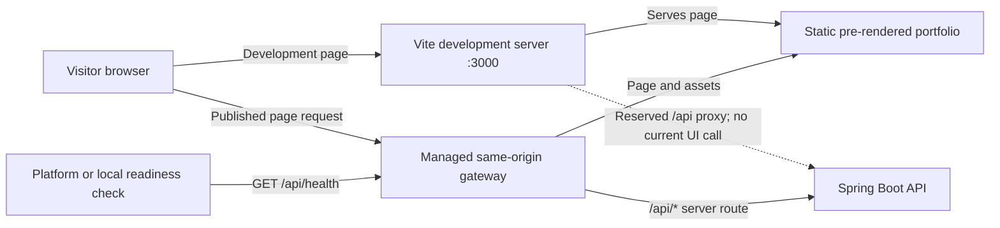

# Architecture

## Overview

The portfolio is intentionally split into a static React frontend and a small Java API. Static content belongs in TypeScript data files. The backend has one current purpose: it exposes an unauthenticated health endpoint for local checks and deployment readiness. The visitor-facing page has no current API-backed feature and does not call that health endpoint. No database is needed for profile or project content. The supplied email and profile links are shown directly; no contact form is implemented because no email delivery service is configured.

## Request flow

During development, Vite serves the page on port 3000. Its `/api` proxy maps any local browser request under that path to the Spring Boot server on port 8080, although no current page feature makes such a request. The health endpoint can be checked directly with `curl` and by deployment readiness probes.

For production, the static build is uploaded separately from the server container under the same public origin. The managed route table sends `/api/*` to Spring Boot and `/*` to static output. The readiness check calls `GET /api/health`; the current portfolio page does not. A future genuine server-backed feature can use a relative `/api` URL without creating a separate browser origin. There is no cross-origin contact form or CORS allow-all rule.

The static build executes a Vite client build and an SSR build of the React application. `scripts/prerender.mjs` inserts the server-rendered React markup into `dist/index.html`; the browser then hydrates that markup. This keeps the public story, project summaries and metadata available in the initial HTML without adding a separate rendering server.

## Frontend responsibilities

`App.tsx` composes the page. `Navbar.tsx` provides the brand and section anchors, with an explicit mobile menu button. `Hero.tsx` presents the supplied positioning and portrait. The optimized photo is tracked under `frontend/public/images/` and served as `/images/thando-majola.webp` in both Manus Preview and a future Vercel build. The About, Projects and Technical Focus sections are isolated in `sections/`. `ProjectCard.tsx` shows one project summary, any supplied repository links, and a native expandable case study; `WorkflowDiagram.tsx` renders the salon flow as text and responsive HTML rather than a tiny raster image. `ContactSection.tsx` renders supplied email, LinkedIn, GitHub and CV links and does not collect form submissions.

`data/profile.ts`, `data/socialLinks.ts`, `data/projects.ts` and `data/technicalFocus.ts` keep personal facts and project copy separate from markup. `types/project.ts` describes optional achievement, image, repository and demo fields. Missing or inaccessible optional links are not rendered. Repository-backed stack claims and the verification sources are documented in `docs/project-stack-verification.md`.

## Backend responsibilities

`PortfolioApplication.java` starts Spring Boot. `controller/HealthController.java` handles `GET /api/health` and returns a small `HealthResponse` JSON record. It does not reveal environment details. `HealthControllerTest.java` exercises this controller through Spring MVC and MockMvc. There is no controller/service abstraction for contact because no delivery process exists yet.

## Configuration limits

The backend listens on the `PORT` environment value when the managed container supplies it and defaults to 8080 for local development. The deployment container defaults `PORT` to 3000 and advertises that same port. Secrets are not needed by the current application; `.env.example` contains only empty, optional public URL variables. The health route is unauthenticated by design so a deployment readiness check can access it.
